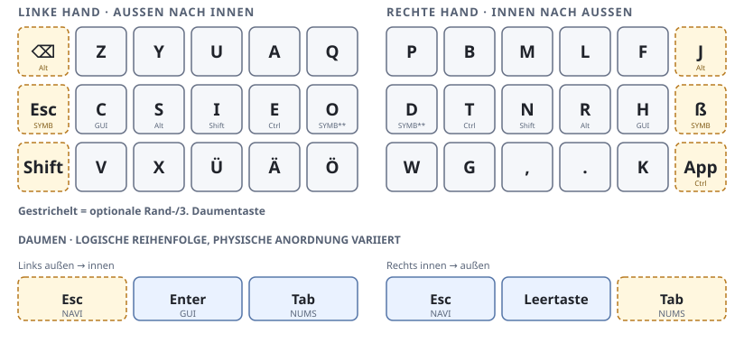
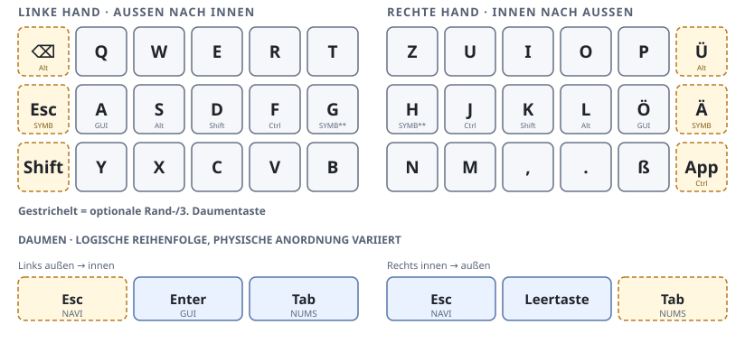
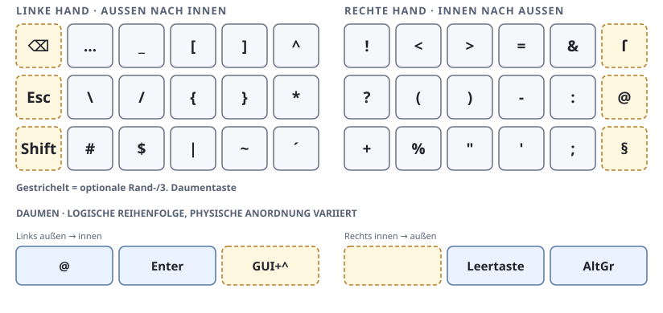
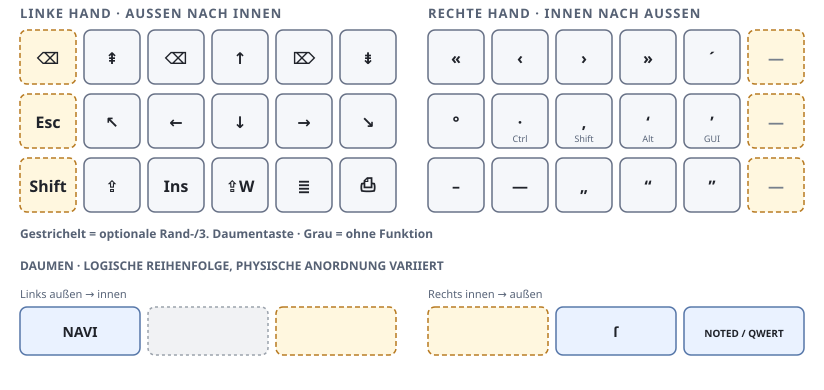
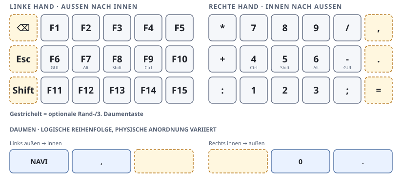

# Layout-Übersicht

Die Grafiken zeigen Haupt- und Daumentasten in einer allgemeinen,
geteilten Anordnung. Orange, gestrichelte Tasten markieren optionale äußere
Spalten und optionale dritte Daumentasten. Auf den Grundebenen liegt die
optionale Daumentaste außen; auf den zusätzlichen Ebenen liegt sie innen.
Fehlt sie an der Tastatur, entfällt sie; die übrigen Tasten werden nicht
verschoben. Grau gestrichelte Tasten sind nicht belegt oder geben die
darunterliegende Ebene frei.

`DE_*`-Keycodes bezeichnen Tasten des deutschen QWERTZ-Layouts. Die Darstellung
unten zeigt die ausgegebenen Zeichen bzw. Funktionen; Modifikatortasten bei
Tap-Hold-Belegungen sind zusätzlich erklärt.

## Grundebenen

`NOTED` und `QWERT` sind die beiden auswählbaren Grundebenen. Die aktive
Grundebene bleibt über einen Neustart hinweg gespeichert.

### NOTED

### QWERT

In der mittleren Reihe sind pro Hand vier Tasten zugleich Modifikatortasten:
links GUI, Alt, Shift und Ctrl, rechts Ctrl, Shift, Alt und GUI. Beim Tippen
senden sie weiterhin den jeweiligen Buchstaben. Mit `COMBO_ENABLE` sind die
mit `**` markierten Mitteltasten als `LT(SYMB, Taste)` konfiguriert; sonst
senden sie nur den Buchstaben. Zusätzliche Buchstabenkombinationen sind in der
NOTED-Ebene L+F → J und R+H → ß, in der QWERT-Ebene O+P → Ü und L+Ö → Ä.

## Zusätzliche Ebenen

Diese Ebenen werden je nach Tastatur über die zugehörigen Daumentasten
aktiviert und verschwinden beim Loslassen.
Tastaturen mit Zeigegerät können zusätzlich die optionale `PNTR`-Ebene
bereitstellen.

### SYMB — Symbole

### NAVI — Navigation und Satzzeichen

Die rechten Satzzeichentasten der mittleren Reihe geben beim Tippen `·`, `‚`,
`‘` und `’` aus. Gedrückt gehalten wirken sie als Ctrl, Shift, Alt bzw. GUI.

### NUMS — Zahlen und Funktionstasten

### PNTR — Zeigegerät (optional)

`PNTR` wird nur einkompiliert, wenn die Firmware `POINTING_DEVICE_ENABLE`
aktiviert. Die Ebene enthält Trackball-/Maussteuerung, Maustasten und
Modifikatortasten. Ihre konkrete Belegung hängt von der jeweiligen
Zeigegeräte-Konfiguration ab und ist nicht für jede Tastatur Teil der Firmware.

## Daumenbelegungen

Die Daumengrafiken verwenden logische Positionen, keine verbindliche
Tastaturgeometrie. Zwei Daumentasten pro Seite sind als reguläre Positionen
gezeigt; die äußere dritte Taste ist optional für Tastaturen mit mindestens
drei Daumentasten auf der Seite. Die Positionen können je nach Layout fehlen
oder physisch anders angeordnet sein. Die Firmware ordnet die Funktionen den
vorhandenen Positionen der jeweiligen Tastatur zu.

## Schreibweise und Verhalten

- `LT(Ebene, Taste)`: Tippen sendet `Taste`; Halten aktiviert `Ebene`.
- `LGUI_T(X)`, `LALT_T(X)`, `LSFT_T(X)` und entsprechende rechte Varianten:
  Tippen sendet `X`; Halten aktiviert den jeweiligen Modifikator.
- `KC_TRNS` (transparent) lässt die darunterliegende Ebene durchscheinen;
  `KC_NO` hat keine Funktion.
- Die Taste zum Umschalten der Grundebene wechselt zwischen NOTED und QWERT
  und speichert die Auswahl dauerhaft.
